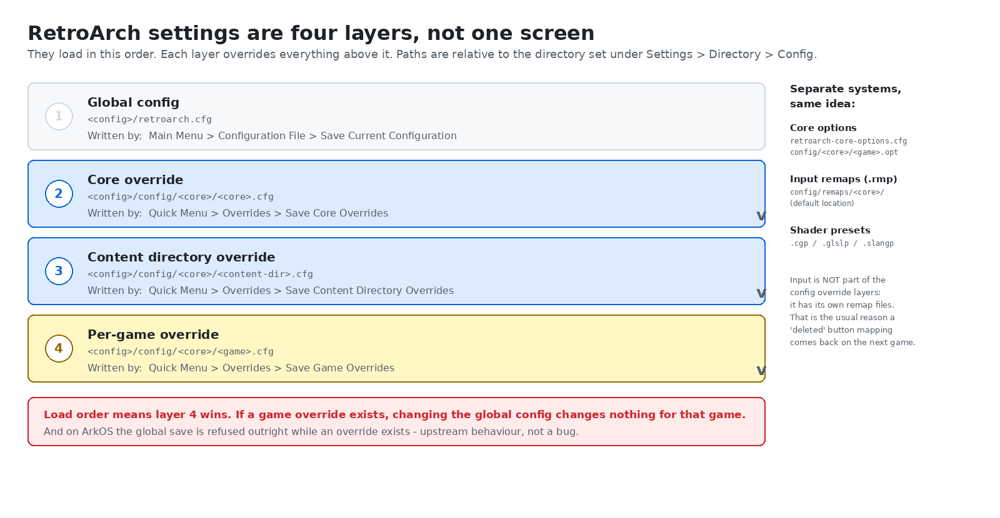
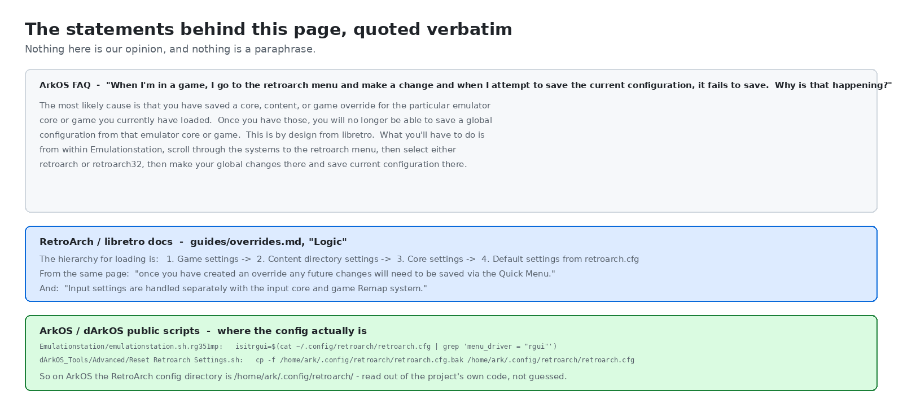
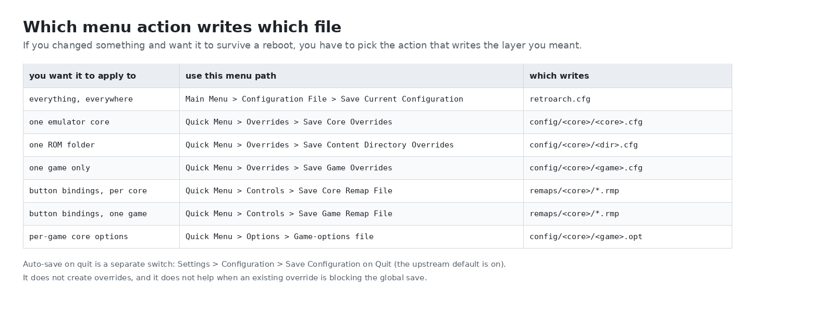
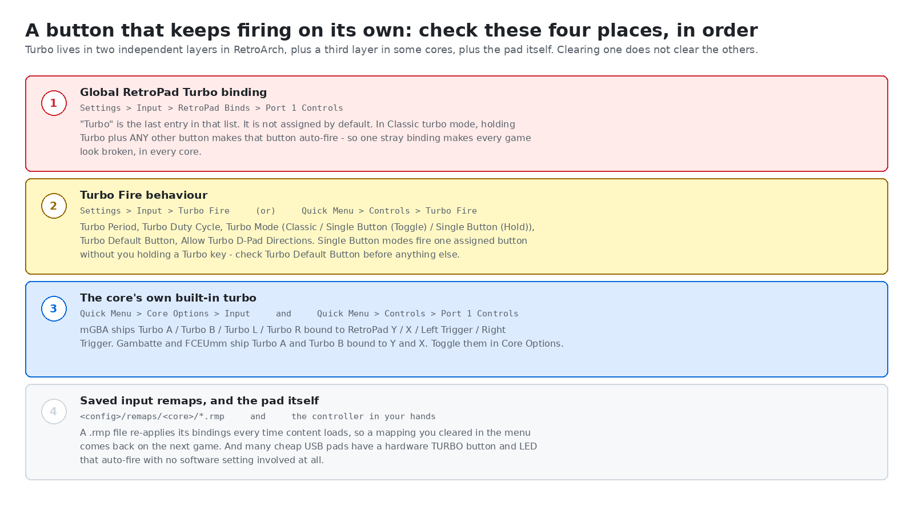
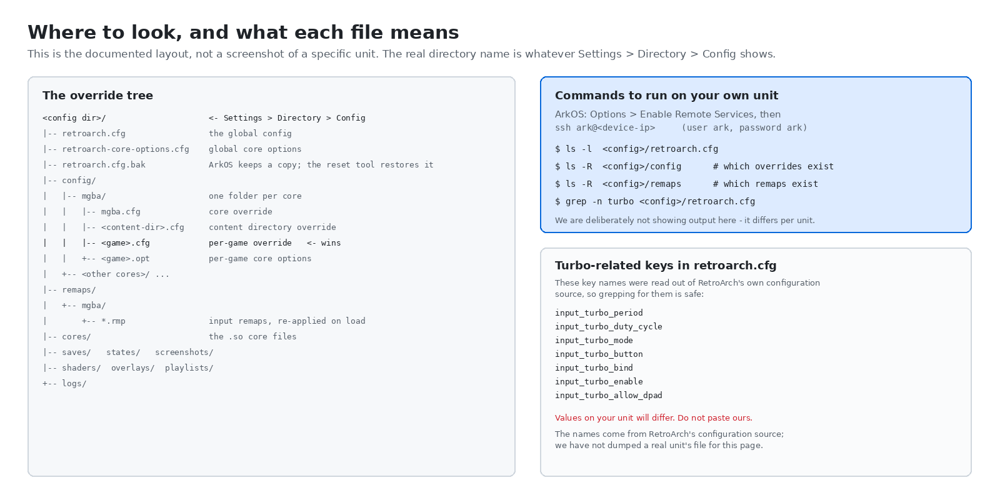

# R36S emulator settings won't save, and the turbo button won't turn off

> **Short answer, two parts.**
> **(1) Settings:** RetroArch stores settings in four layers — global, per-core, per-content-directory and per-game. The layers load on top of each other, and **once a core, directory or game override exists, RetroArch refuses to save the global config from inside that game. That is upstream behaviour, not a bug.** Save to the layer you actually meant, from the menu item that writes that layer.
> **(2) Turbo:** an auto-firing button is a *turbo* binding, and turbo exists in **two independent layers in RetroArch plus a third layer inside some cores**, and input bindings live in their own `.rmp` remap files rather than the normal config. Clearing one place does not clear the others.

Written for the R36S and its ArkOS-family firmware, but the RetroArch half applies to any handheld running RetroArch.

Terminology note for anyone coming from a Chinese-language forum: what those threads call 全能模拟器 ("the all-in-one emulator") is **RetroArch**. The scope of this page is the same thing.

---

## 1. The symptom, in the words people actually use

Quotes from Chinese-language handheld Q&A groups. **Group name only** — the source dataset does not carry reliable per-message attribution, so no usernames are given.

> `[r36s（开源掌机）交流1群]` 我搞一上午都搞不明白，他这个全能模拟器设置修改以后怎么保存的，一退出去设置又变回原来的样子。
> *"I spent a whole morning on this and still don't get how you're supposed to save settings in RetroArch. I change something, exit, and it's back to the way it was."*

> `[r36s（开源掌机）交流1群]` 连发键设置后，所有游戏都是连发了，请问怎样取消
> *"After setting up a turbo key, every game auto-fires. How do I cancel it?"*

> `[安伯尼克掌机交流群]` rg35xxh的A在主界面没啥问题在全能模拟器玩GBA会连发，但是我看控制里面没有设置连发什么问题
> *"On the RG35XXH the A button is fine in the frontend, but inside RetroArch playing GBA it auto-fires. I looked in Controls and there's no turbo set — what's going on?"*

> `[安伯尼克掌机交流群]` 官方系统那个搜索游戏一直不知道怎么搜索
> *"On the stock system I've never worked out how to search for a game."*

> `[r36s（开源掌机）交流1群]` 这个掌机一搜索游戏，返回主页，游戏就显示搜索到的几个，不能显示全部
> *"Once you search for a game and go back to the home screen, only the few games it found are shown — it won't show all of them."*

> `[r36s（开源掌机）交流1群]` 有大神知道吗？为什么我玩这个游戏屏幕那么小😂点菜单也没有可以设置的
> *"Does anyone know why this game runs in such a tiny area? I opened the menu and there's nothing to set."*

> `[安伯尼克掌机交流群]` 玩模拟器不设置，是不行的
> *"With emulators, you have to configure things. You can't just not."*

Look at the third quote again, because it contains the whole puzzle: the user checked **Controls** and found no turbo, yet the button fires. It is not in Controls. It is in two other places, and one of them is not part of the config system at all.

---

## 2. Why: RetroArch settings are four layers, not one screen

RetroArch does not have "the settings". It has a stack of plain-text config files, loaded in this order, each overriding the one above:

| # | layer | file (relative to the config directory) | written by |
|---|---|---|---|
| 1 | Global | `retroarch.cfg` | Main Menu → Configuration File → Save Current Configuration |
| 2 | Core override | `config/<core>/<core>.cfg` | Quick Menu → Overrides → Save Core Overrides |
| 3 | Content directory override | `config/<core>/<content-dir>.cfg` | Quick Menu → Overrides → Save Content Directory Overrides |
| 4 | Per-game override | `config/<core>/<game>.cfg` | Quick Menu → Overrides → Save Game Overrides |

The official libretro documentation states the loading order as *"Game settings → Content directory settings → Core settings → Default settings from `retroarch.cfg`"*, and the directory is the one you set under **Settings → Directory → Config** (the underlying setting key is `rgui_config_directory`).

Three further systems sit alongside the config layers rather than inside them:

- **Core options** — `retroarch-core-options.cfg` globally, plus a per-game `<game>.opt` inside `config/<core>/`. The docs note that game-specific options only load automatically if "Load Content Specific Core Options Automatically" is on.
- **Input remaps** — `.rmp` files, by default under `config/remaps/<core>/`. The docs are explicit: *"Input settings are handled separately with the input core and game Remap system."*
- **Shader presets** — their own files (`.cgp` / `.glslp` / `.slangp`).

<div align="center">

</div>

### The rule nobody tells you

The ArkOS project documented this as a frequently asked question, and the answer is unusually direct:

> **Q. When I'm in a game, I go to the retroarch menu and make a change and when I attempt to save the current configuration, it fails to save. Why is that happening?**
>
> **A.** The most likely cause is that you have saved a core, content, or game override for the particular emulator core or game you currently have loaded. Once you have those, you will no longer be able to save a global configuration from that emulator core or game. **This is by design from libretro.** What you'll have to do is from within Emulationstation, scroll through the systems to the retroarch menu, then select either retroarch or retroarch32, then make your global changes there and save current configuration there.

The libretro docs say the same thing from the other direction: *"once you have created an override any future changes will need to be saved via the Quick Menu."*

So the person who "changes a setting, exits, and it's back to the way it was" is usually not failing to save. They are succeeding at loading an override that already says something else.

<div align="center">

</div>

### Where the files actually are on an R36S-class ArkOS build

`/home/ark/.config/retroarch/` — and this is not a guess. Two lines from the public ArkOS / dArkOS source:

```sh
# Emulationstation/emulationstation.sh.rg351mp
isitrgui=$(cat ~/.config/retroarch/retroarch.cfg | grep 'menu_driver = "rgui"')

# dArkOS_Tools/Advanced/Reset Retroarch Settings.sh
cp -f /home/ark/.config/retroarch/retroarch.cfg.bak /home/ark/.config/retroarch/retroarch.cfg
```

⚠️ **Not verified on hardware.** We read those lines out of the projects' repositories; we have not run them against a live unit in this session. Your build may differ, and the authoritative answer for any individual device is what **Settings → Directory → Config** reports.

---

## 3. How to fix it

### Step 1 — Decide which layer you want, before you touch anything

<div align="center">

</div>

Ask yourself: *do I want this everywhere, or only for this emulator / this folder / this one game?* Then use the matching row. The single most common mistake is making a change that feels global while an override exists.

### Step 2 — If "Save Current Configuration" seems to do nothing

That is the case documented above. In order:

1. Confirm an override is actually there: open **Quick Menu → Overrides** while the game is running. If the entries read *Delete Core Override* / *Delete Game Override* rather than *Save …*, an override exists.
2. Either **delete the override** and then save globally, or **make the change where the override lives** — i.e. re-save the override with the new value.
3. If you genuinely want a global change and the override should stay for other reasons, use the route the ArkOS answer gives: quit to the frontend and open **the RetroArch entry in the EmulationStation menu**, not RetroArch from inside a game. There is no content loaded there, so no override is in force and the global save goes through.

### Step 3 — If the setting survives a game exit but dies at the next power-off

- Check **Settings → Configuration → Save Configuration on Quit**. In upstream RetroArch this defaults to **on** (`DEFAULT_CONFIG_SAVE_ON_EXIT true` in `config.def.h`), which is why most people never hit this. If it is off, nothing is written on exit and every change dies with the process.
- Confirm the file is writable and not being regenerated. A real example of a frontend rewriting the config behind your back, from the public ArkOS/dArkOS launcher script:

  ```sh
  sed -i '/input_exit_emulator_btn/s//;input_exit_emulator_btn/g' /home/ark/.config/retroarch/retroarch.cfg
  ```

  That line comments out a config key when you choose to boot straight into RetroArch instead of the frontend. The launcher also edits `menu_driver` and `xmb_menu_color_theme` in the same file. ⚠️ We read this in the repository; we have not reproduced the sequence on a unit. The point stands regardless: on this firmware family, `retroarch.cfg` is not exclusively yours.

### Step 4 — The reset tool does less than you think

ArkOS ships an **Advanced → Reset Retroarch Settings** option. Its message reads:

> *"This process will restore the default retroarch settings. Use this if you can't open the retroarch menu anymore. Be aware that any global setting changes you've changed will be reverted to the default settings as initially set from the most recent update."*

And the entire body of the script is one line:

```sh
cp -f /home/ark/.config/retroarch/retroarch.cfg.bak /home/ark/.config/retroarch/retroarch.cfg
```

It restores `retroarch.cfg` **and nothing else**. Your overrides under `config/<core>/` and your remaps under `remaps/<core>/` are untouched by it. So "I reset RetroArch and it *still* won't save my global settings" has an obvious explanation: **the override that blocks the global save is still sitting there.** Delete it explicitly.

⚠️ **Not verified on hardware** — this is a reading of the script in the public repo, not a recorded run on a device.

---

## 4. Turbo / autofire: the button that will not stop

Turbo means "rapid fire": hold the key down and the button fires repeatedly. It is deliberately **not** in the Controls screen where the person in §1 went looking. There are four places to check, and they are independent.

<div align="center">

</div>

**1. The global RetroPad Turbo binding.**
`Settings → Input → RetroPad Binds → Port 1 Controls`. Per the official RetroArch documentation, *"Turbo can be found at the bottom of the list"*, and *"It isn't assigned by default."* Once assigned, in **Classic** turbo mode, *"holding the turbo button at the same time as any other button causes that button to turbo."* That single sentence explains the second quote in §1: one stray Turbo binding plus Classic mode equals *every game auto-fires*.

**2. The Turbo Fire behaviour options.**
`Settings → Input → Turbo Fire`, or while a game is running, `Quick Menu → Controls → Turbo Fire`. Five options exist:

- **Turbo Period** — how often the turbo input repeats.
- **Turbo Duty Cycle** — how long each turbo input is held.
- **Turbo Mode** — `Classic`, `Single Button (Toggle)`, `Single Button (Hold)`. The two Single Button modes fire one assigned button *without* you holding a Turbo key at all.
- **Turbo Default Button** — the one button the Single Button modes act on.
- **Allow Turbo D-Pad Directions**.

If turbo fires with no Turbo key held, you are in a Single Button mode and **Turbo Default Button** is the thing to clear.

**3. The core's own built-in turbo.** Some cores implement turbo themselves, inside the core, and the Retropad bindings reflect that:

| core | built-in turbo bindings (RetroPad names, per the official docs) |
|---|---|
| mGBA (GBA) | Turbo A → **Y**, Turbo B → **X**, Turbo L → Left Trigger, Turbo R → Right Trigger |
| Gambatte (GB/GBC) | Turbo A → **Y**, Turbo B → **X** |
| FCEUmm (NES) | Turbo A → **Y**, Turbo B → **X**, Turbo A+B → Right Thumb |

They are switched on or off under `Quick Menu → Core Options → Input` (documented as an option to enable the turbo buttons for player 1 and/or player 2), and their targets are visible under `Quick Menu → Controls → Port 1 Controls`. **This is the most likely answer to the "A auto-fires in GBA but Controls shows no turbo" case**: the auto-firing input is the core's Turbo A, bound to the RetroPad Y position, and on a handheld whose physical face buttons do not match the RetroPad lettering, that lands on whatever button the launcher maps to Y.

**4. Saved remaps, and the pad itself.**
`<config>/remaps/<core>/*.rmp`. A remap file is re-applied every time content loads, which is exactly why clearing a binding in the menu appears to work for one session and then "comes back". Look for `.rmp` files under the config directory's `remaps/` folder and delete or re-save them.

And outside the software entirely: many inexpensive USB gamepads have a physical **TURBO** button that latches an LED and auto-fires one button with no software setting involved. If a pad is plugged in, unplug it and retest before you spend an evening in menus.

**Order of operations to turn turbo off:**

1. `Quick Menu → Controls → Port 1 Controls` — clear the Turbo binding (the input dialog shows an unassigned button as `---`).
2. `Quick Menu → Controls → Turbo Fire` (or `Settings → Input → Turbo Fire`) — set **Turbo Default Button** to none/off so the Single Button modes have nothing to act on; check Turbo Mode.
3. `Quick Menu → Core Options → Input` — turn off the core's Turbo A / B / L / R if present.
4. Clear or re-save any `.rmp` remap for that core, so step 1 does not get undone on the next load.
5. Save: `Main Menu → Configuration File → Save Current Configuration`, and if an override exists, re-save it too — otherwise you have only fixed today's session.

⚠️ **Not verified on hardware.** Every menu path and option name above is taken from the official RetroArch documentation and the official libretro docs on overrides; we did not perform this sequence on an R36S for this page. The exact on-screen wording of the "unassigned" state and of the turbo-off choice varies between RetroArch versions.

---

## 5. "Search games" and the frontend index

Two separate things get called "search" on these devices, and both of the group complaints in §1 are about the second one.

**RetroArch's own search** is a search box inside the RetroArch menu, for finding an entry in RetroArch's playlists. It is not how you find a ROM on the card, and it does not affect the frontend.

**The frontend's game list** — EmulationStation-family — is an index, not a live search. It reads each system's folder and builds a **gamelist**, then shows you that list. So "search shows only a few games and won't show all of them" is almost always an index/filter problem, not a search problem.

The ArkOS project's own answer to *"I've added the roms to the appropriate folder, but once I put the SD card inside the console it doesn't seem to find my roms"* is a three-item checklist:

> - The roms are in the supported extension for the system per the Emulators and Ports section
> - Try pressing start then go to **UI Settings** then **visible systems** and make sure to **select all**.
> - Try pressing start then go to **Advanced settings** and be sure **parse gamelists only** is off.

Read the second and third bullets as the index controls:

- **"Visible systems → select all"** is the fix for a systems list that has been narrowed down — which is precisely the "only shows a few, can't show all" complaint.
- **"Parse gamelists only → off"** is the index rebuild switch. With it on, the frontend only reads the existing cached gamelist and does not rescan the folders, so newly copied ROMs never appear. Turning it off forces a real scan.

A community-reported detail for the Anbernic stock-OS family, from a group post about organising an SD card:

> `[安伯尼克掌机交流群]` 卡格式建议：ntfs/exFAT 每个压缩包下载后解压出来的文件夹放入卡上根目录即可在RG前端里面按X进行扫描。
> *"Card format suggestion: NTFS/exFAT. Unzip each archive and put the resulting folders in the card's root; then in the RG frontend press X to scan."*

That "press X to scan" behaviour is specific to that vendor's frontend. ⚠️ **Not verified:** we have not confirmed the Anbernic stock-OS search menu or its scan key, and we are relaying a group post rather than testing it. Menu wording differs between frontend builds, so treat any exact label on a non-ArkOS build as "look for the equivalent entry".

⚠️ **Also not verified:** the *RetroArch* menu path for the RetroArch-internal search box differs between `rgui` and `xmb` menu drivers, and ArkOS has historically switched between them. We did not verify the label on either driver for this page.

---

## 6. How to verify the change stuck

Do these in order, and stop at the first one that fails — it tells you which layer is fighting you.

1. **Exit the game normally**, back to the frontend, then re-enter the same game. If the value reverted here, an override owns it.
2. **Power off fully and boot again**, then re-enter the game. If it reverted here but survived step 1, nothing was ever written to disk — check Save Configuration on Quit, and check whether the file is writable.
3. **Load a different game on the same core.** If your change followed you there, you saved at core level. If it did not, you saved at game level.
4. **List what is actually on the card.** Over SSH (ArkOS: *Options → Enable Remote Services*, then log in as `ark` / `ark`), the config directory is the one RetroArch reports under **Settings → Directory → Config**:

   ```sh
   ls -l  <config>/retroarch.cfg          # global config, and its timestamp
   ls -R  <config>/config                 # every core / content-dir / game override
   ls -R  <config>/remaps                 # every saved input remap
   grep -n turbo <config>/retroarch.cfg   # turbo keys, if you are chasing autofire
   ```

<div align="center">

</div>

The turbo-related key names above (`input_turbo_period`, `input_turbo_duty_cycle`, `input_turbo_mode`, `input_turbo_button`, `input_turbo_bind`, `input_turbo_enable`, `input_turbo_allow_dpad`) were read out of RetroArch's own configuration source, so grepping for them is reliable. **We are deliberately not printing values, because values differ per unit.** The same applies to the `ls` output — we did not run these against a live R36S for this page, so the commands are given without sample output.

**Reading the timestamps is often enough on its own.** If `retroarch.cfg` still shows the same modification time you saw before you saved, nothing was written. If a `.cfg` under `config/<core>/` has today's timestamp, that is the override that is winning.

---

## 7. How not to step in it again

- **One change at a time, then check.** Save, exit the game, re-enter it. If you change five things at once you cannot tell which layer swallowed which.
- **Know that overrides are sticky.** Creating one silently disables the global save from that core or game. If you do not have a reason for an override, do not create one.
- **Prefer the frontend's RetroArch entry for global changes.** No content loaded, no override in play, the save goes where you expect.
- **Remember input lives elsewhere.** Button bindings go in `.rmp` remaps, not in the config layers. If a button is behaving oddly, look at remaps and at the core's own options before anything else.
- **Do not leave a global Turbo bound.** It is the cheapest way to make every game on the device look broken.
- **Back up the config directory before you experiment.** ArkOS also exposes a built-in **Backup dArkOS Settings** option in its launcher menu, which is a reasonable starting point. Copying `/home/ark/.config/retroarch/` to a PC costs nothing and makes everything above reversible.
- **Understand that "root cause" here is usually "wrong layer", not "broken save".** The settings system is working exactly as designed; it is just not designed the way the on-screen menu makes it look.

---

## 8. FAQ

**Does RetroArch have one settings file?**
No. There is one global file plus three override layers, plus separate systems for core options, input remaps and shader presets.

**Why does "Save Current Configuration" do nothing inside a game?**
Because an override exists for that core, content directory or game. Upstream RetroArch deliberately refuses the global save while an override is in force. Delete the override, or make the change from the frontend's RetroArch entry with nothing loaded.

**I reset RetroArch to defaults and it still won't save. Why?**
Because the ArkOS reset tool restores `retroarch.cfg` only. Overrides live in a different folder and survive the reset.

**Where is the turbo setting?**
Not in Controls. The global binding is `Settings → Input → RetroPad Binds → Port 1 Controls` (last entry). The behaviour options are under `Settings → Input → Turbo Fire` or `Quick Menu → Controls → Turbo Fire`. Some cores have their own turbo inside `Quick Menu → Core Options → Input`.

**Why does only GBA auto-fire, and only in RetroArch?**
mGBA has built-in Turbo A and Turbo B bound to RetroPad Y and X, and it is enabled from the core's own options. Nothing in the frontend knows about it, which is exactly why it appears "only in RetroArch".

**My new ROMs never appear. What rebuilds the list?**
The frontend's scan. On ArkOS that is `Start → Advanced settings`, with **parse gamelists only** turned **off**; and `Start → UI Settings → visible systems → select all` if the system list itself is narrowed.

---

## 9. Related

- Board revisions and finishes on our store: <https://r36s.space/products/r36s>
- Setup and first-boot notes: <https://r36s.space/guide>
- Frequently asked questions: <https://r36s.space/faq>

### Sources used on this page

- [Using Content, Folder, and Core Overrides for Custom Settings](https://github.com/libretro/docs/blob/master/docs/guides/overrides.md) — libretro documentation. Used for the override load hierarchy, the `<config>/config/<core>/…` file locations, the statement that input settings are handled by a separate remap system, and the note that future changes must be saved through the Quick Menu.
- [How to Set Up a Turbo Button in RetroArch](https://docs.retroachievements.org/general/tutorials/turbo-button.html) — used for the exact menu paths for the global Turbo binding and Turbo Fire, the five Turbo Fire options, the per-core turbo bindings for mGBA, Gambatte and FCEUmm, and the "Save Current Configuration" / "Save Configuration on Quit" paths.
- [ArkOS — Frequently Asked Questions](https://github.com/christianhaitian/arkos/wiki/Frequently-Asked-Questions---RG351MP) — used verbatim for the "it fails to save" answer, for the three-point checklist about ROMs not appearing, and for the ArkOS SSH credentials and the `Enable Remote Services` step.
- [dArkOS](https://github.com/christianhaitian/dArkOS) and [(d)ArkOS4Clone](https://github.com/lcdyk0517/arkos4clone) — public repositories. Used for the `/home/ark/.config/retroarch/` config path, the `Reset Retroarch Settings` script body, the launcher's `sed` edits to `retroarch.cfg`, and the existence of the `Backup dArkOS Settings` option in the launcher menu.
- RetroArch source — `configuration.c` for the `rgui_config_directory` and `config_save_on_exit` setting keys and the `input_turbo_*` keys, and `config.def.h` for the `DEFAULT_CONFIG_SAVE_ON_EXIT true` default.

**Corrections and additions are welcome via issues or pull requests** — especially from anyone who can confirm the exact menu wording on a current ArkOS build.
